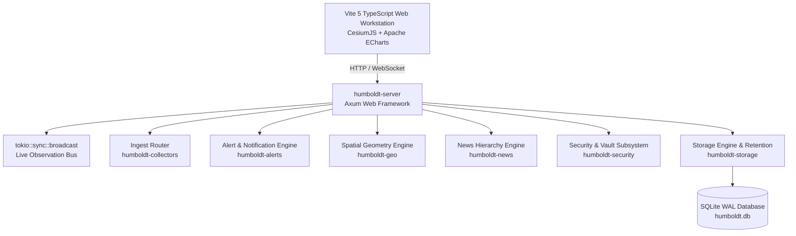
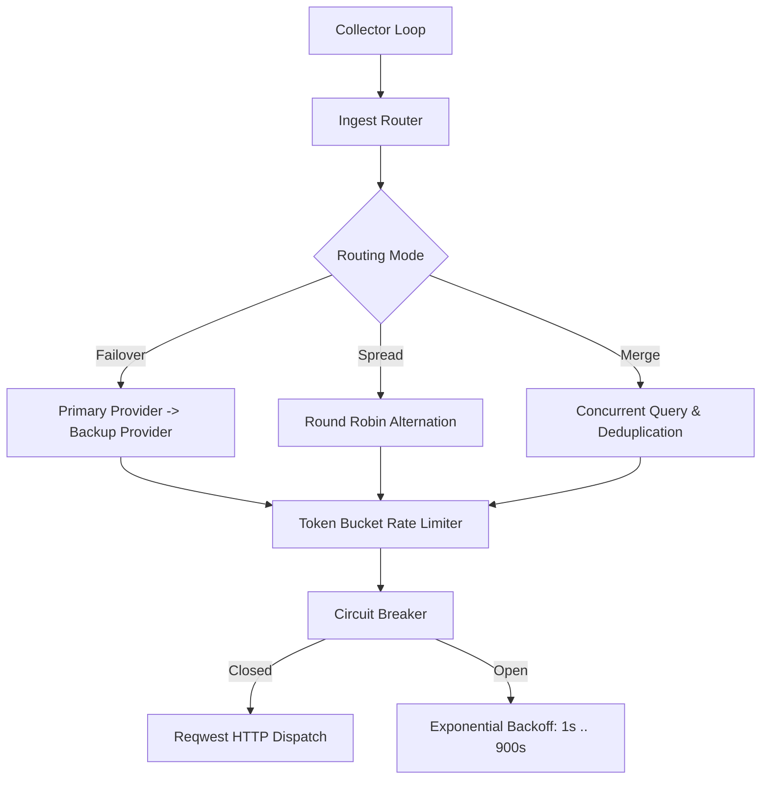
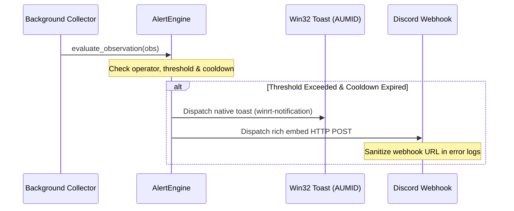

# HUMBOLDT Architectural Specification & System Blueprints

This document details the engineering design, system topology, data structures, and operational workflows of **HUMBOLDT: Analytics & Real-time Global Information System**.

---

## 1. System Topology & Workspace Map

HUMBOLDT is architected as a modular Rust workspace backed by an embedded Vite 5 TypeScript single-page application (SPA). All application layers are decoupled through strict interface contracts in `crates/humboldt-core`.



### Crate Manifest
* **`crates/humboldt-core`:** Domain types, error definitions, canonical telemetry contracts (`Observation`, `LayerType`), `AppPaths`, `AppConfig`, and snapshot mathematical models. Zero external runtime service dependencies.
* **`crates/humboldt-storage`:** Asynchronous SQLite engine via `sqlx`. Manages WAL mode, foreign keys, schema migrations, downsampling rollups, retention sweepers, and disk cap enforcement.
* **`crates/humboldt-security`:** AES-256-GCM encrypted vault with OS keyring integration (`keyring` crate) and fallback file keys. Argon2id LAN authentication, session cookie validation, and exponential brute-force rate limiters.
* **`crates/humboldt-collectors`:** Resilient multi-provider ingestion framework with `TokenBucket` rate-limiting and exponential `CircuitBreaker`. Parsers for USGS Earthquakes, CelesTrak TLE (with local SGP4 geodetic propagation), ADS-B aviation, AIS maritime, NOAA SWPC space weather, Open-Meteo, National Grid ESO, and CAIDA IODA.
* **`crates/humboldt-geo`:** Sub-millisecond offline spatial indexing engine using Douglas-Peucker simplified polygons and R-Tree spatial indexing (`rstar`).
* **`crates/humboldt-news`:** GDELT DOC 2.0 and Google News RSS aggregator with geographic fallback hierarchy (`City → County → State → Country`) and proximity provenance tagging (`[Direct]`, `[Regional]`, `[Statewide]`).
* **`crates/humboldt-alerts`:** In-memory alert evaluation engine. Emits native Win32 Desktop Toast notifications (`winrt-notification`) under AUMID `Humboldt.Desktop` and formatted Discord rich embeds with sanitized URL logging.
* **`crates/humboldt-server`:** Axum HTTP server embedding compiled frontend assets via `rust-embed`. Provides single-instance Win32 mutex coordination, dynamic port allocation (8374–8378), headless environment detection, and system tray management.

---

## 2. Process Lifecycle & Execution Flow

### 2.1 Initialization & Single-Instance Mutex
1. **Entrypoint:** Executable entrypoint is marked `#![windows_subsystem = "windows"]` to prevent command prompt / console flashes on Windows systems.
2. **Single-Instance Mutex:** Queries the named Win32 mutex `Global\HumboldtAppMutex`.
   * If already locked, HUMBOLDT reads the active port from `%APPDATA%\Humboldt\.active_port`, opens the running instance in the user's default browser, and exits immediately (`ExitCode(0)`).
   * On non-Windows platforms, file-based lock semantics ensure single-process execution.
3. **Port Hunting:** Sweeps the deterministic port range `8374` through `8378`. If all ports are occupied, a native dialog displays a diagnostic message and execution halts cleanly.
4. **Headless Environment Detection:**
   * Evaluates `HUMBOLDT_HEADLESS`, `DOCKER`, `/.dockerenv`, and display handles (`DISPLAY`, `WAYLAND_DISPLAY`).
   * When headless mode is active, the system tray thread, browser launcher, and Win32 message boxes are completely bypassed without crashing.

---

## 3. Storage Architecture & Tiered Retention

HUMBOLDT uses SQLite with Write-Ahead Logging (`PRAGMA journal_mode = WAL;`) and relaxed synchronization (`PRAGMA synchronous = NORMAL;`) to provide high ingestion throughput without database locking bottlenecks.

```text
Time Horizon:
0h ────────────── 2h ──────────────────────────── 48h ─────────────────────────────── 365d
│  RAW TELEMETRY  │   DOWNSAMPLED (1 pt/min)      │   HOURLY ROLLUPS (metric_rollups) │
│  Aircraft, AIS, │   Linear downsampling for     │   min, max, avg, count aggregated │
│  Quakes, Sens.  │   high-rate temporal series   │   for permanent trend analysis    │
└─────────────────┴───────────────────────────────┴───────────────────────────────────┘
```

### 3.1 3-Tier Storage Lifecycle
1. **Real-time Tier ($< 2\text{ hours}$):**
   * Stores raw, high-resolution observations (ADS-B positions, AIS vessel updates, seismic events).
   * Serves real-time WebSocket feeds and short-term dead-reckoning filters.
2. **High-Resolution Tier ($2\text{ to } 48\text{ hours}$):**
   * High-rate continuous observation streams are downsampled to a maximum density of 1 point per entity per minute.
3. **Historical Rollup Tier ($48\text{ hours to } 365\text{ days}$):**
   * Aggregates raw observations into `metric_rollups_hourly` (`min_value`, `max_value`, `avg_value`, `sample_count`).
   * Purges raw observation rows older than 48 hours to preserve disk space.
4. **Disk Cap Enforcement (10 GB Cap):**
   * The background retention worker runs every 10 minutes.
   * If the SQLite database exceeds 90% of the disk cap ($9.0\text{ GB}$), an emergency FIFO cleanup purges the oldest historical records until the database returns to safe thresholds.

---

## 4. Telemetry Ingest & Resilient Router

External feeds frequently suffer from network drops, rate limits, and server-side timeouts. HUMBOLDT wraps all data collection within an adaptive Ingest Router:



### Routing Modes
* **Failover:** Ingests from the primary endpoint (e.g., `adsb.lol`). If repeated HTTP errors or timeouts trip the circuit breaker, queries automatically failover to secondary endpoints (`airplanes.live`).
* **Spread:** Distributes requests evenly across mirror providers to minimize upstream server load.
* **Merge:** Queries multiple concurrent feeds and deduplicates entities by ICAO transponder hex or MMSI maritime identifiers.

### SGP4 Geodetic Satellite Propagation
Satellite orbits are fetched from CelesTrak Two-Line Element (TLE) sets and propagated locally using SGP4 celestial orbital models. Spacecraft position vectors are translated to geodetic coordinates ($\text{Latitude}, \text{Longitude}, \text{Altitude}$) via Bowring's algorithm, producing high-fidelity tracks entirely offline.

---

## 5. Spatial Geometry & Reverse Geocoding Engine

Clicking on the Cesium 3D globe requires immediate spatial resolution from geographic coordinates $(\phi, \lambda)$ to political hierarchy (`Country → State → County → City`).

1. **Preprocessed Bundled Geometries:**
   * Natural Earth country and state boundaries and Census places are pre-simplified via the Douglas-Peucker algorithm ($\epsilon = 0.001^\circ \approx 111\text{ meters}$).
   * Geometry payloads are compiled directly into the binary, keeping total bundle footprint under $45\text{ MB}$.
2. **R-Tree Indexing (`rstar`):**
   * Polygon bounding boxes (AABBs) are loaded into an in-memory R-Tree.
   * Coordinate lookups filter candidate polygons in $O(\log N)$, followed by exact Ray-Casting Point-in-Polygon (PIP) verification.
   * Spatial queries resolve in $< 1 \text{ ms}$ offline with zero external network overhead.

---

## 6. Snapshot Comparison & Statistical Divergence Engine

HUMBOLDT allows operators to "freeze" any active time series into a compressed analytical snapshot stored in SQLite with Gzip compression.

### Dual-Mode Temporal Alignment
* **Calendar Mode:** Aligns series by absolute UTC timestamps ($T_A = T_B$).
* **Relative Day-of-Period Mode:** Normalizes both series to start at $T_0 = 0$, enabling direct baseline comparison between anomalous periods (e.g., comparing Hurricane season 2024 to Hurricane season 2023).

### Statistical Divergence Metrics
$$\Delta \text{Mean} = \mu_B - \mu_A$$
$$\Delta \text{Max} = \max(B) - \max(A)$$
$$\Delta \text{Min} = \min(B) - \min(A)$$
$$\text{NRMSD} = \frac{\sqrt{\frac{1}{N}\sum_{i=1}^{N}(B_i - A_i)^2}}{\max(A) - \min(A)}$$

---

## 7. Security Architecture & LAN Access Model

### 7.1 Encrypted Vault & Master Keys
* Sensitive credentials (Discord webhooks, provider API keys) are encrypted using **AES-256-GCM** with 96-bit unique nonces.
* Master encryption keys are stored in the OS credential store (Windows Credential Manager / Secret Service via `keyring`). In headless Docker environments, the master key is derived from a persistent keyfile (`.master_key`) stored in the mounted `/data` volume.

### 7.2 LAN Authentication & Plain HTTP Sessions
When LAN mode is enabled (`--lan` or `HUMBOLDT_LAN_MODE=1`), HUMBOLDT binds to `0.0.0.0` and gates remote access:
* **Password Verification:** Passwords are hashed with **Argon2id** (memory cost $19,456\text{ KiB}$, time cost 2 iterations, parallelism 1).
* **Session Cookie:** Issued as `humboldt_session`. To accommodate homelab environments operating over plain HTTP on private IP addresses (`192.168.x.x`), session cookies strictly omit the `Secure` flag while enforcing `HttpOnly; SameSite=Strict; Path=/`.
* **Escalating Rate Limiting:** Failed login attempts trigger exponential IP-based backoff delays ($1\text{s}, 2\text{s}, 4\text{s}, 8\text{s}, \dots, 60\text{s}$).

---

## 8. Alerting & Notification Dispatch



* **Desktop Notifications:** Windows notifications are dispatched through native Windows Runtime APIs registered under Application User Model ID `Humboldt.Desktop`.
* **Discord Rich Embeds:** Color-coded alert cards (Yellow Advisory, Orange Watch, Red Warning) are formatted with entity coordinates, observed values, and deep links.
* **Webhook URL Redaction:** Webhook URLs are stripped of private channel tokens in all debug logs and error messages using `sanitize_webhook_url()`.
